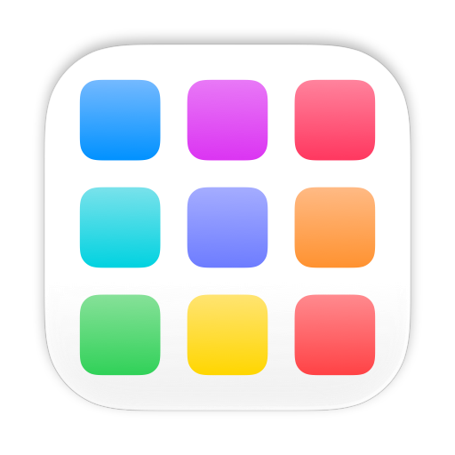
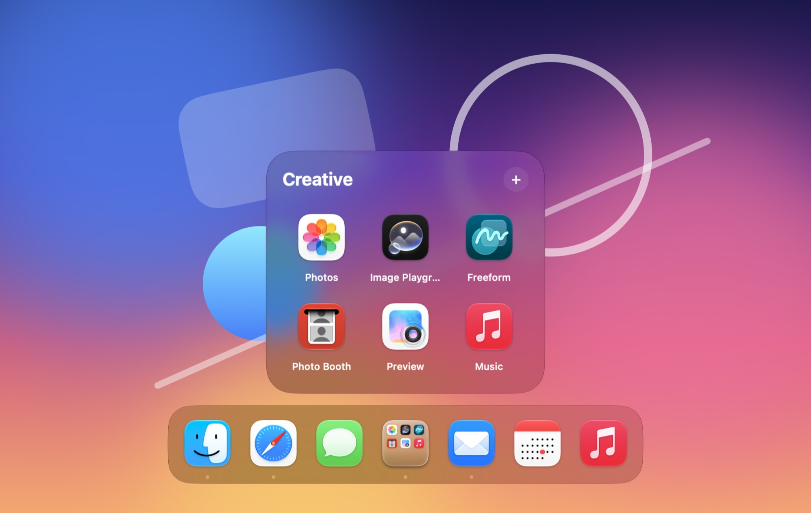
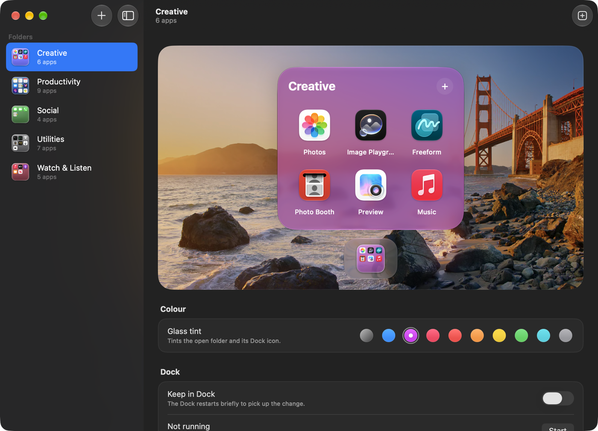

<p align="center">
  
</p>

<h1 align="center">DockFolder</h1>

<p align="center">
  iPhone-style app folders that live in the macOS Dock, drawn in Liquid Glass.<br>
  <a href="https://github.com/breidenbach0/DockFolder/releases/latest/download/DockFolder.dmg"><b>Download DockFolder.dmg</b></a>
  ·
  <a href="https://breidenbach0.github.io/DockFolder/">Website</a>
</p>

<picture>
  <source media="(prefers-color-scheme: light)" srcset="docs/images/hero-light.jpg">
  
</picture>

DockFolder turns a group of apps into a single Dock icon. Click it and the apps open in a glass grid just above it, like a folder on iPhone. It doesn't replace the Dock, uses no private APIs and needs no special permissions. Native Swift (AppKit and SwiftUI).

## Install

1. **Download** [DockFolder.dmg](https://github.com/breidenbach0/DockFolder/releases/latest/download/DockFolder.dmg) from the [latest release](https://github.com/breidenbach0/DockFolder/releases/latest).
2. **Open the disk image** and drag **DockFolder** onto the **Applications** folder next to it.
3. **Open DockFolder.** It isn't notarized by Apple, so macOS asks first. If it says it couldn't verify DockFolder, click **Done**, open **System Settings › Privacy & Security**, scroll down and click **Open Anyway**. You only do this once. Or run this in Terminal:

   ```bash
   xattr -dr com.apple.quarantine /Applications/DockFolder.app
   ```

4. **Make your first folder** with the **+** button.

Needs macOS 13 Ventura or later, on Apple silicon or Intel. Liquid Glass needs macOS 26 or later; earlier versions get a frosted blur instead.

## Use it

**Make a folder.** In the DockFolder window, click **+** (or press ⌘N), name the folder, pick a colour, a layout and some apps (choose them, or drop them in), and click **Create Folder**. It's saved to `~/Applications/Dock Folders`, kept in the Dock and started. You can also drop apps onto DockFolder's own Dock icon to start a folder with them.

**Pages or a grid.** Each folder lays out its apps one of two ways:

- **Pages:** 9 apps a page (3 × 3), like a folder on iPhone. A new page starts after every 9 apps, up to 3 pages (27 apps). Turn the page by swiping with two fingers, clicking the dots, or pressing ← and →.
- **Grid:** every app on one page, up to 6 × 6 (36 apps).

A full folder turns away more apps. You can only switch to a layout that has room for the folder's apps.

**Use it in the Dock.**

- Click the folder's icon to open it above the Dock. Click an app to open it.
- Close the folder with Esc, a second click on its icon, or a click anywhere else.
- Drop apps onto the folder's icon or from the Finder onto the open folder to add them, or click **+** in the open folder.
- Drag an app to another spot to rearrange them: it follows the pointer and the other apps make room. With pages, hold it at the left or right side of the folder; that side glows, and the page turns. Or press ← or → while you hold it.
- To move an app from your Dock into a folder, open the folder, then drag the app up out of the Dock onto it. The folder's outline lights up. Wait until the Dock shows **Remove**, then let go: the app leaves the Dock and goes in the folder. (The Dock never hands its icons to other apps, so the folder watches for the app the Dock removes.)
- Right-click an app in the folder to move it left or right, or remove it.
- To have folders ready after a restart: right-click the folder's Dock icon › **Options › Open at Login**.

**Change a folder.** Select it in the DockFolder window. You get a live preview of it on glass over your desktop picture, where you can open, add, rearrange (by dragging) and remove apps. Under the preview, a glass Dock shows the apps in your Dock: drag one up into the folder to move it there, out of your Dock. The Dock restarts once, a moment after the last app you move. Below the preview you can change its glass tint (clear, nine ready-made colours, or any colour from the rainbow well, which opens the colour panel) and its layout, rename it, keep it in the Dock or take it out, start it, show it in Finder, or move it to the Trash. Folders made by an older version get an **Update** button that rebuilds them and keeps their apps, colour and place in the Dock.

<picture>
  <source media="(prefers-color-scheme: light)" srcset="docs/images/window-light.png">
  
</picture>

**Update.** DockFolder looks for a new version on GitHub when you open it, and once a day while it's open. When there is one, a card at the bottom of the sidebar offers **Install Update**: DockFolder downloads it, checks it against the release, puts it in place of itself, starts again and updates your folders, which keep their apps, colours and places in the Dock. **DockFolder › Check for Updates…** looks right away; turn off **Check for Updates Automatically** in the same menu to stop the daily look. (Installing needs DockFolder in a folder you can write to, such as Applications.)

**Uninstall.** Delete your folders in the DockFolder window, then drag DockFolder from Applications to the Trash. Folder settings live in `~/Library/Application Support/DockFolder`.

## Build from source

You need Xcode 15 or later.

```bash
git clone https://github.com/breidenbach0/DockFolder.git
cd DockFolder
scripts/build-app.sh          # builds build/DockFolder.app (Apple silicon and Intel)
open build/DockFolder.app     # the DockFolder window
```

- `scripts/make-dmg.sh` builds `build/DockFolder.dmg`, the download, and `build/DockFolder.zip`, which the in-app updater installs. Attach both to a release, and bump the version in `scripts/build-app.sh` first: the updater only installs a release whose app has the version its tag says.
- `scripts/make-folder.sh "Design" --pin` makes a folder without the window.
- `swift test` runs the tests: grid placement, layout sizes and limits, page swipes, rearranging, saving, colours, edits from two processes, bundle IDs and names, building, rebuilding and renaming signed folders, Dock tiles, the app icon, and updating DockFolder from a stand-in release.
- `open Package.swift` edits it in Xcode. Running from Xcode starts a bare binary that runs as a folder; pass `-DockFolderRole manager` to get the DockFolder window (making folders needs the app bundle). To test real Dock behaviour, build the app and make a folder.

Folders are copied from the DockFolder app you run, so after rebuilding, click **Update** on each folder.

## How it works

- **Each folder is its own small app.** Its Dock icon *is* the folder: a glass tile with a 3×3 preview of the apps inside, drawn live and tinted in the folder's colour.
- **Click the icon** and the folder opens just above it on Liquid Glass, growing out of the Dock. The app reads the Dock's side and icon size from the Dock's own preferences, and uses the pointer position (which is on the icon) to place the grid.
- **Drop apps onto the icon** to add them. The app's Info.plist declares that it accepts `.app` bundles, so the Dock accepts the drop.
- **One codebase, many folders.** Opened directly, `DockFolder.app` is the window where you make and change folders. Each folder is a copy of it with its own name and bundle ID, so it gets its own Dock slot and its own data file. The `DockFolderRole` key in Info.plist decides which of the two a copy is.
- **The window and the folders stay in sync.** Both edit the same JSON file; after saving, each posts a distributed notification and the other re-reads it.

| File | What it does |
| --- | --- |
| `App.swift` | Entry point (DockFolder window or folder), folder app delegate: Dock click (reopen), drops, Dock menu, live Dock icon |
| `FolderStore.swift` | The folder's apps and colour, saved as JSON; finds moved apps by bundle ID; picks up edits from the other process |
| `PanelController.swift` | The floating glass grid window: open and close animations, position, Esc |
| `DockGeometry.swift` | Which edge the Dock is on and where the grid goes |
| `FolderView.swift` | The open folder on glass, the 6 × 6 grid, and fixed layout sizes |
| `FolderPages.swift` | Pages of 9 apps: swipes, page dots and arrow keys |
| `Rearranging.swift` | Moving apps within a folder: the app follows the pointer, and holding it at a side (or pressing ← →) turns the page |
| `FolderDrag.swift` | Apps dropped on a folder from the Finder, and apps dragged out of the Dock onto it |
| `FolderStyle.swift` | The two layouts, pages and grid, and how many apps each holds |
| `FolderIcon.swift` | Draws the glass folder icon from the first nine app icons, and DockFolder's own icon |
| `FolderTint.swift` | The colours a folder's glass can be tinted, ready-made or any colour (saved as #RRGGBB) |
| `Glass.swift` | Liquid Glass helpers, with blur fallbacks for macOS 13–15 |
| `Manager/ManagerApp.swift` | The DockFolder window app |
| `Manager/ManagerView.swift` | Sidebar of folders and the welcome screen |
| `Manager/FolderDetailView.swift` | A folder's live glass preview over the desktop picture, and its settings |
| `Manager/NewFolderSheet.swift` | Name, colour and apps for a new folder |
| `Manager/RenameFolderSheet.swift` | A new name for a folder |
| `Manager/StylePicker.swift` | The choice between pages and the grid |
| `Manager/TintPicker.swift` | Colour swatches, and the well that opens the colour panel |
| `Manager/FolderLibrary.swift` | Finds the folders; makes, renames, updates and deletes them; Dock and running status |
| `Manager/FolderFactory.swift` | Builds folder apps from `DockFolder.app`, the same steps as `make-folder.sh` |
| `Manager/DockPreferences.swift` | Reads and writes the apps kept in the Dock |
| `Manager/Updater.swift` | Looks for new releases on GitHub, installs them in place of DockFolder, and updates the folders after |
| `Manager/UpdateCard.swift` | The card at the bottom of the sidebar about an update |

The website lives in `docs/` and is served by GitHub Pages.

## Known limitations

1. **A folder must be running** to show its live icon and react to clicks. When it quits, the Dock shows the last icon written into the bundle (`persistIconToBundle` in `App.swift`; the DockFolder window writes it too when it changes a folder that isn't running). The Dock sometimes caches the old one until you run `killall Dock`.
2. **Folders appear in ⌘-Tab** while they're running.
3. **The grid is positioned from the pointer**, not from the icon's exact frame. Getting the exact frame would need Accessibility permission. It can sit slightly off with magnification turned on.
4. **The persisted icon is written into the app bundle** as a custom Finder icon. That's fine for ad-hoc signed local copies, but it conflicts with the code-signing seal of a notarized app, so it needs rethinking before notarizing.
5. **Not notarized or sandboxed.** The download is ad-hoc signed, which is why macOS asks before opening it the first time.
6. **Keeping a folder in the Dock restarts the Dock**, because the Dock only reads its list of apps when it starts. Adding, renaming or removing a kept folder does this.
7. **A new or updated folder can be slow to open the first time.** Gatekeeper checks each ad-hoc-signed app it hasn't seen before, including an online notarization lookup; when that lookup timed out, the first launch waited about 80 seconds (later launches are instant). Developer ID signing and notarization remove the wait.

## Roadmap

1. **Hide folders from ⌘-Tab.** Split the app into one background agent (`LSUIElement`) that owns all folders and their grids, plus tiny per-folder stub apps that only tell the agent "open folder X" and then quit. Test early whether writing icons into the stub apps triggers macOS's App Management prompt.
2. **Drag an app out** of a folder to remove it, or onto the Dock to keep it there.
3. **Keyboard:** arrow keys plus Return, and type to filter.
4. **Appearance:** icon size, and more layouts.
5. **Shipping:** Developer ID signing, notarization and Sparkle updates.

## License

[MIT](LICENSE) © 2026 Simon Breidenbach. Not affiliated with Apple.
